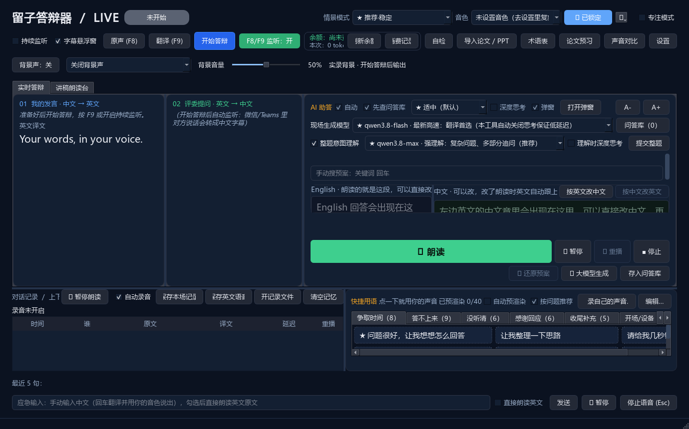

# 留子答辩器

**专门为留学生开会和答辩准备的 Windows 双向语音辅助工具。**

和导师开会时听懂问题，用中文组织回答，再用自己的克隆音色说出英文；准备答辩时，把论文、讲稿和常见问题放到一个工作台里，提前试听、练习和保存。

[](https://github.com/Viper-Boss/teams-voice-translator/actions/workflows/ci.yml)
[](LICENSE)


[使用说明](答辩模式使用说明.md) · [更新日志](CHANGELOG.md) · [问答库格式](问答库格式说明.md) · [参与开发](CONTRIBUTING.md)

> 当前源码版本：**1.16.18**。主入口是 `run_defense.bat`，打包程序为 `DefenseMode.exe`。名称更新后仍沿用原来的配置和录音目录。
> [Releases](https://github.com/Viper-Boss/teams-voice-translator/releases) 中的成品版本可能早于 main 分支，请核对版本号；本次更新以源码为准。



## 适合哪些场景

| 场景 | 可以怎么用 |
| --- | --- |
| 导师会议、课题讨论 | 看英文原文与中文翻译，直接用原声回答，或说中文后翻成英文发声 |
| 组会与远程汇报 | 先整理术语和讲稿，提前合成语音，现场按段播放 |
| 论文答辩准备 | 导入论文和 PPT，整理问题、核对答案，用第一人称练习回答 |
| 答辩现场 | 评委字幕、整题理解、问答库和讲稿在同一窗口操作 |
| 会后复盘 | 查看双语记录，回听麦克风、老师声音和混合录音 |

## 主要功能

- **双向字幕与发声**：对方英文转为中文字幕；自己的中文可翻译并合成为英文。字幕悬浮窗支持播放进度高亮。
- **原声与翻译切换**：默认 `F8` 原声直通，`F9` 中文转英文；可选择按住说话或持续模式。`F8/F9 监听` 单独控制这两个通道的本机试听。
- **独立评委识别**：评委识别运行在独立进程中，自己发声时仍可接收评委提问。
- **整题理解与 AI 助答**：字幕照常翻译；另选理解模型汇总完整提问，再结合已导入的论文背景生成第一人称参考答案。可在主界面或助答弹窗操作。
- **讲稿朗读台**：按段整理、预渲染和播放，显示总时长、当前位置与剩余时间；已合成音频保存在本机。
- **问答库与快捷用语**：导入、编辑、检查和提前渲染常见回答；用快捷用语争取思考时间、确认问题或请求重复。
- **人声播放互斥**：播放答案、讲稿等语音时暂停 F8/F9 输入，避免自己的原声与合成回答叠在一起；背景声单独控制。
- **录音与归档**：老师声音、自己的麦克风和混合声音分别保存。显示实际录音状态和老师音频已保存时长；切换音色或模型时保持录音，更换录音设备时另存片段。

AI 生成内容需要结合自己的研究核对；它是沟通与准备工具，不会替你验证论文结论，也不承诺固定翻译延迟或音色完全一致。

## 第一次使用

需要 Windows 10/11、麦克风、耳机，以及自己的阿里云百炼账号与可用模型权限。把声音送进会议还需要 [VB-CABLE 虚拟声卡](https://vb-audio.com/Cable/)。软件不附带 API Key、云服务额度或驱动。

### 1. 启动程序

已有打包版：完整解压文件夹，运行其中的 `DefenseMode.exe`。

从源码运行：安装 64 位 Python 3.12，然后在项目目录执行：

```powershell
Set-ExecutionPolicy -Scope Process Bypass
.\setup.ps1
.\run_defense.bat
```

`run.bat` 保留为经典课堂模式入口；本文默认介绍主答辩工作台。

### 2. 配置账号与音色

打开「设置」，填写 Workspace ID 和 API Key，选择当前账号可用的识别、翻译与语音合成模型。克隆音色需要与合成模型匹配；切换模型后先试听，确认是自己的声音。

现场发声和提前渲染可以使用同一套模型与音色，也可以分别设置。听起来不一致时，先核对两套配置、语气指令和已缓存的旧音频。

### 3. 连接会议音频

| 位置 | 选择 |
| --- | --- |
| 软件 → 麦克风 | 自己实际说话的麦克风 |
| 软件 → 程序输出 | `CABLE Input` / 对应虚拟声卡的输入端 |
| 会议软件 → 麦克风 | 同一条虚拟声卡的 `CABLE Output` |
| 会议软件 → 扬声器 | 听导师或评委的耳机 |
| 软件 → 对方声音回环 | 上一行耳机对应的 `[Loopback]` |
| 软件 → 试听设备 | 自己听合成语音的耳机或输出设备 |

**CABLE Input 和 CABLE Output 名称相反是正常的：软件向 Input 播放，会议从 Output 接收。**

为了避免试听声音再次进入评委识别，试听设备可以使用另一条独立音频输出。并非必须准备两副耳机，关键是播放与捕获设备的路由要正确。完整说明见[四种设备的分工](答辩模式使用说明.md#四种音频设备的分工)。

### 4. 先试一小段

运行「自检」，让会议另一端说一句话，确认英文原文和中文翻译都出现；再分别试 F8、F9 与讲稿播放。勾选自动录音后，确认状态显示「老师录音中」且已保存时长增长，结束后打开录音文件回听。

## 录音到底保存在哪里

默认位置是 `文档\DefenseMode\答辩_时间\`，可在设置中修改。也可以直接点「打开记录文件夹」。

```text
答辩_时间/
├── 录音/
│   ├── microphone_时间_标识.wav       自己的麦克风
│   ├── teacher_system_时间_标识.wav   评委所用播放设备的声音
│   └── meeting_mixed_时间_标识.wav    两轨混合
├── 会议全记录.md
└── 字幕/
    ├── 中文字幕.txt
    ├── 英文字幕.txt
    └── 双语字幕.txt
```

同场续录可能生成多个片段，请一起保留。`teacher_system` 录下的是所选设备播放的声音，设备上的其他声音也可能录入。

**「保存英文语音」保存的是软件合成语音，不是老师的原声录音。** 如果没有配置评委回环，只能录到自己的麦克风，界面会提示。转写字幕不能替代原声备份，也不能还原未保存的录音。

## 费用与隐私

- 云端识别、翻译、理解、回答生成、声音复刻和合成可能产生费用，按自己的服务商账号计费；费用统计与余额查询不保证同步反映账单。
- 录音、字幕、论文、讲稿和音频缓存保存在本机；使用云模型时，相应音频、文本、论文上下文或样音会发送给所选服务。具体范围取决于启用的功能。
- API Key 等凭据通过 Windows 凭据管理器保存；不要把自己的数据目录、日志或内存快照上传仓库。
- 录音与 AI 辅助的使用应符合会议和学校要求，并取得相关参与者同意。详见[安全与数据说明](SECURITY.md)。

## 构建与参与

```powershell
# 本机运行版：dist\DefenseMode\DefenseMode.exe
.\build_defense.ps1

# 分享版：排除个人主题，生成压缩包与说明
.\build_share.ps1
```

开发与测试方法见 [CONTRIBUTING.md](CONTRIBUTING.md)。本项目使用 [GPL-3.0-or-later](LICENSE)；随附环境音素材的来源见 [CREDITS.md](teams_voice_translator/ambience_assets/CREDITS.md)。仓库路径暂时沿用 `teams-voice-translator`。
